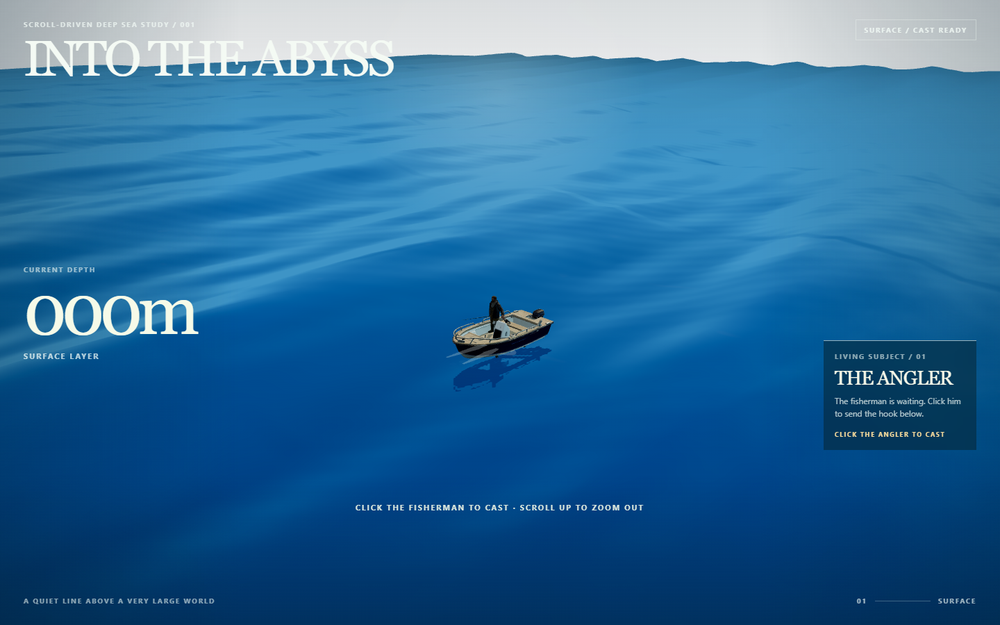

# Into the Abyss — 潜入深海

一个以滚动叙事驱动的实时 3D 海洋网页原型。现在聚焦于海面和 0–80 米水层：用户先从远处看到海面与钓鱼船，镜头缓慢靠近；点击渔夫后播放抛竿动画，随后滚动页面，镜头沿鱼线进入水下并遇见海洋生物。



## 体验内容

- 动态海面、波浪反射、海面与天空的分层，以及随浪轻摇的小船。
- 开场镜头推进；点击渔夫抛竿后才开放下潜，避免页面刚打开就直接进入水下。
- 鼠标滚轮或触摸向下滑动，沿鱼钩探索 0–80 米；在海面向上滚动可拉远视角，拖动可改变观察方向。
- 0–40 米包含饵鱼群、绿海龟和月亮水母；40–80 米包含翻车鱼与大青鲨。点击生物可打开观察百科。
- 深度驱动生物的出场、游动和退场；模型加载期间有可交互的回退表现。

## 本地运行

需要 Node.js。安装依赖并启动开发服务器：

```bash
npm install
npm run dev
```

生产构建：

```bash
npm run build
```

项目使用 Vite 与 Three.js。当前只覆盖海面至 80 米，不是完整的 11,000 米深海旅程；模型细节、移动设备性能和抛竿动作仍有继续打磨空间。

## 交互顺序

1. 进入页面：停留在海面，渔夫等待，镜头从远处靠近小船。
2. 点击渔夫：播放一次抛竿动画。
3. 抛竿完成后：向下滚动或触摸上滑，沿鱼线进入水下；点击生物查看百科，关闭后继续下潜。

线上演示入口：[193.112.28.146/into-the-abyss](http://193.112.28.146/into-the-abyss/)。注意：线上部署版本尚未更新到本仓库的“点击渔夫后抛竿”开场逻辑；以本地运行的仓库版本为准。

## 资产说明

网页运行所需模型位于 `public/models/`。船、渔夫、海龟、饵鱼和月亮水母包含 Lux3D 生成并经 Blender 整理的模型；翻车鱼与大青鲨为项目内制作的简化示意模型。详细来源与当前已知限制见 [ASSET_PROVENANCE.md](ASSET_PROVENANCE.md) 和 [VESSEL_QA.md](VESSEL_QA.md)。
